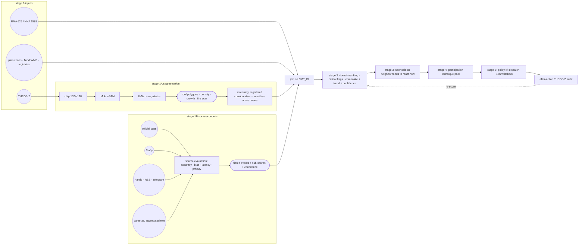

# Slide plan: genuine spatial insight, regional specificity, practical applicability

Maps the remaining judging criteria to concrete slides for the deck, continuing the
series started by `slides_plan_ml_data_criteria.md` (which covered AI/ML credibility,
data pipeline, and limitations). Every claim below is backed by something that exists
in the repo or on the live site — evidence pointers given per slide.

Criteria covered:

1. Does the output produce a genuine spatial insight meaningful to decision-makers?
2. Is it specific to the regional context and practically applicable?

Plus two closing sections designed as deck "tabs" (and proposed as new site tabs):

- **Tab: Decision pipeline** — the end-to-end tool for metropolitan data-driven
  decision making: segmentation branch + socio-economic branch, domain ranking,
  selection, participation technique pool, policy kit dispatch.
- **Tab: Participation techniques** — classification built from the 49-case slum
  policies review, with failure modes and Thailand-specific additions.

---

## Part 1 — Genuine spatial insight, meaningful to decision-makers

**What a judge listens for:** the word "insight" defined before it is used, insight
shown as *decisions that change*, not as pretty layers. A judge is hostile to
"we made a map of slums" — that map already exists (BMA has 626 polygons). The
insight must be something no single register contains, on a unit an officer can
act on (the community polygon, `CMT_ID`), with a named Monday-morning action.

### Slide 1.1 — Define the bar: what counts as a spatial insight

- Definition used throughout: a finding that (a) is spatially explicit, (b) could
  not be read from any single source, (c) is attached to a polygon a district
  officer can visit and budget, and (d) changes a decision.
- Non-examples we reject: re-displaying the BMA slum register; a choropleth with
  no action attached; city-wide "slum detection" claims.
- Visual: the test as a four-item checklist, reused as a stamp on slides 1.2–1.6.
- Evidence: this framing is already implicit in `proposal.html` ("stale data to
  policy kit" story).

### Slide 1.2 — Insight #1: the two registers do not describe the same city

- 1,588 NHA points vs 626 BMA polygons: **71% of NHA points fall outside BMA
  community polygons** (325 outside all BMA boundaries, 128 marked planning-use).
- That mismatch is not an error to hide — it is a finding: different dates,
  definitions and boundaries mean the city's own records cannot answer "where do
  we act next" without reconciliation.
- Decision it changes: produces a **reconciliation worklist** (244 review areas:
  154 with no register overlap to inspect, 90 with overlapping boundaries to
  reconcile) — a survey queue, not a claim of new settlements.
- Evidence: deck pages 02–05 (cross-register mismatch, review queue);
  `datamatch.html`.

### Slide 1.3 — Insight #2: quantified exposure on named communities

- Flood: more than 11 registered informal communities, ~320 households, ~1,070
  people live **outside the flood walls** — enumerated community by community,
  six coordinate-matched, five unconfirmed.
- Fire: SEA assessment year 2568 lists 6 high/critical communities — **three of
  six cluster in Wang Thong Lang**. The cluster itself is the insight: one
  district office, one inspection route, one budget line.
- Decision it changes: a ranked inspection/priority route instead of an
  undifferentiated list of 626.
- Evidence: deck pages 09–10; `slum.html` SEA layers; BMA risk registry FY 2568.

### Slide 1.4 — Insight #3: burdens compound on the same polygons

- Community income ~1,964 THB/person/month vs poverty line 2,762; shared-meter
  electricity ~12 THB/unit vs typical ~3.5 (Bang Na case, ~3.4×).
- The insight is the **join**: income burden + meter burden + Traffy complaint
  backlog + roof density on the *same* `CMT_ID`. No register contains that row;
  the pipeline produces it.
- Decision it changes: utility-meter regularization target list; complaint
  backlog triage tied to a named community, not a district average.
- Evidence: deck page 11; `social.html`; `04_output/social_patterns/`.

### Slide 1.5 — Insight #4: morphology explains *what to look at*, not *who is poor*

- Eighteen morphology descriptors across 40 frames / 28,950 buildings: density
  (inside, ring, count; pairwise ρ ≈ 0.98) dominates; canal distance 0.60.
- Framed honestly: spatial AUC 0.733 sits **below our own pre-set classification
  gate** — so the model output is used as a screening signal (where to send
  enumerators), never as a settlement verdict. "*The map does not establish
  poverty, tenure or legality.*"
- This slide is the credibility anchor for Part 1: insights 1–3 are trusted
  because insight 4 refuses to overclaim.
- Evidence: deck pages 06, 13; `morphology_diagnostic_table.csv`,
  `group_membership.csv`, `phase5_results.json`.

### Slide 1.6 — The insight product is a ranked, tiered work queue

- Per-community sub-scores per domain (fire, flood, services, complaint
  intensity, street economy, tenure pressure) with critical-condition flags,
  composite 0–100, trend arrow, confidence flag (T1–T4 match tiers).
- Publication guardrail (from the proposal's Q3 position): internal
  investment-priority tool; published only as **budget tiers**, never a ranked
  league table, with data-blindness flags.
- One sentence takeaway: *same polygon key carries pixels, complaints, and
  zoning — the ranking on that key is the deliverable, not the map.*
- Evidence: `proposal.html` score engine; `04_output/social_patterns/`.

---

## Part 2 — Specific to the regional context

**What a judge listens for:** the tool could not be copy-pasted from another
country's hackathon; Thai institutions, Thai language, Thai data infrastructure
are load-bearing; and the boundary of transferability is stated.

### Slide 2.1 — Built on Thai data infrastructure, natively

- THEOS-2 (GISTDA, Thai satellite, 0.5 m) as the sensor; BMA community polygons
  and NHA registry as ground truth; DPT comprehensive plan zones (ผังเมืองรวม)
  for land-use overlay; Vallaris flood WMS; gdcatalog crime statistics;
  Traffy Fondue as the complaint layer.
- No imported slum register, no OpenStreetMap "poverty" proxy, no foreign
  ground truth. Every layer has a named Thai public owner.
- Evidence: `README_social_pipeline.md` source inventory; deck page 08;
  `index.html` live GISTDA/LDD tiles.

### Slide 2.2 — Thai-language processing is a first-class component

- Gazetteer of 3.7k slum-name variants derived from the 626 BMA polygons (Thai
  script spellings included); `pythainlp` tokenization; Thai-language event
  lexicon; Pantip and t.me/s ingestion.
- Point: English-only pipelines are blind to exactly the sources where Bangkok's
  neighborhood problems are discussed. Thai NLP is not localization work — it is
  the sensor.
- Evidence: `02_code/social/build_gazetteer.py`, `event_lexicon.yaml`,
  `extract_events.py`.

### Slide 2.3 — The problem shape itself is Thai

- The NHA/BMA dual-register mismatch (slide 1.2) is an artifact of Thai
  governance history, and any Bangkok decision-support tool must absorb it or
  fail. Khlong Toei's partial upgrading is a port-land veto case — land
  ownership structure is the binding constraint, not analytics.
- Fiscal and assessment calendars are Thai (FY 2568 risk registry), and Baan
  Mankong / CODI / NHA are the delivery institutions the tool must plug into.
- Evidence: deck pages 02, 09; `slum_policies.html` Thailand row (Khlong Toei +
  Baan Mankong: 142,254 households, 1,246 projects, 75 provinces).

### Slide 2.4 — Policy kits are seeded from Thai programmes first

- KIT 1 = Baan Mankong 2.0 (CODI); KIT 3 includes Thai land-sharing precedent;
  KIT 6 = CODI-style relocation with common-use dividend. Global cases
  (Jakarta KIP, Favela-Bairro, Medellín PUI, Mukuru SPA) are the adaptation
  evidence, not the starting point.
- Evidence: `proposal.html` kit cards.

### Slide 2.5 — Transferability boundary, stated

- What transfers: pipeline as scripts + runbook + gazetteer step (swap registers
  and scene, order of operations unchanged).
- What does not: the registers themselves, the Thai NLP stack, the institutional
  dispatch (CODI/NHA/BMA), the participation pool.
- Evidence: existing Q&A row in `slides_plan_ml_data_criteria.md` ("Can this run
  on another city?").

---

## Part 3 — Practically applicable

**What a judge listens for:** an owner, a cost, a workflow someone already has,
and guardrails against misuse. "Dashboard" is a negative word; "work-order
generator" is a positive one.

### Slide 3.1 — From insight to action: dispatch, not display

- Score profile triggers a kit via an explicit dispatch table: dense roofs +
  fire → KIT 2 → escalate KIT 1; flood zone + disaster → KIT 4 → KIT 6 if land
  unsafe; complaint backlog + valuable land → KIT 3 → KIT 1; street economy +
  vending complaints → KIT 5; low score + low confidence → field enumeration
  visit first.
- Every terminal state is either a funded programme or an enumeration visit —
  never "monitor".
- Evidence: `proposal.html` dispatch table.

### Slide 3.2 — Feasible at BMA scale, on public infrastructure

- Rule-based Thai NLP: deterministic, auditable, cheap (no LLM inference in the
  loop). U-Net inference: one modest GPU, minutes per scene. Ingestion:
  rate-safe public APIs, robots.txt respected, no API keys in repo.
- After-action satellite audit (THEOS-2 re-run) closes the loop — the same
  sensor that screened verifies delivery.
- Evidence: `02_code/` run order in `README_social_pipeline.md`; gen2 viewer.

### Slide 3.3 — Participation is a pipeline stage, not a promise

- Every kit carries a participation component selected from a classified pool
  (see Tab: Participation techniques), matched to community capacity —
  enumeration before engineering works, collective negotiation before tenure
  instruments.
- Governor-visit protocol (Q1): structured enumeration visits, findings written
  back within 48 hours — participation with a service-level agreement.
- Evidence: `proposal.html` Q1–Q3; `slum_policies.html` participation column.

### Slide 3.4 — Guardrails against misuse, by design

- No public ranked league table (stigmatization guard, Q3); data-blindness flags
  show who the sources miss; KIT 6 (relocation) **never triggered by land value
  alone** — last resort only; common-use dividend is a standing KIT 6 component
  (Q2).
- Evidence: `proposal.html` open-questions positions.

### Slide 3.5 — Limits are wired into the roadmap

- City-wide scenes → scale U-Net; geo-blocked BMA CKAN → Thai-IP fetch;
  snippet-only news → direct-feed expansion; T-tier precision →
  human-in-the-loop review; deferred phases scoped (Traffy 360, FB/TikTok via
  ScrapeCreators).
- Evidence: `README_social_pipeline.md` "Known limits (2026-10-06 run)".

---

## Tab: Decision pipeline (closing section — proposed as a new site tab)

The tool, end to end, for metropolitan urban management. Present as one slide
(the mermaid diagram) plus one slide per stage. This is the "what you would
actually operate" close of the deck.

**Stage 0 — Inputs.** THEOS-2 scenes; BMA 626 polygons + NHA 1,588 (join key
`CMT_ID`); DPT plan zones; flood WMS; registries. Nothing exotic enters here.

**Stage 1A — Satellite segmentation branch (identify slums and sensitive
neighborhoods).** THEOS-2 scene → chips → MobileSAM (Gen 1) → Kabsch/RANSAC
alignment vs Overture → U-Net (Gen 2) → rectilinear regularization → roof
polygons → density / growth / fire-scar indicators → citywide screening
produces a **review queue** (244 areas). Two outputs matter: (a) corroboration
of registered communities, (b) **sensitive neighborhoods** — areas with
slum-like morphology and risk exposure but *no register entry*, flagged for
enumeration, never auto-classified.

**Stage 1B — Socio-economic branch (parallel).** Range of sources, evaluated and
weighted, not just collected:

| Source class | Examples | Strength | Weakness | Role |
|---|---|---|---|---|
| Official statistics | NSO census, NHA/BMA registers, gdcatalog crime, FY 2568 risk registry, plan zones | authoritative, comparable | stale, coarse, register blind spots | backbone / priors |
| Complaint platforms | Traffy Fondue pins | geocoded, fresh, actionable | self-selected complainants | live signal |
| Social media | Pantip, news RSS, Telegram channels | fresh, narrative context | biased to online Thai readers; JS-redirect snippets | context + events |
| Cameras, aggregated as text | CCTV crowd/vendor/activity digests, transit and smart-card aggregates reported as text | spatially precise, fresh | privacy-sensitive — **aggregates only, no individuals, no raw video** | proposed extension |

Cross-source agreement raises the confidence flag; disagreement lowers it and
routes to enumeration. The evaluation is explicit so judges see we know social
data is not truth.

**Stage 2 — Domain ranking.** Per-community sub-scores per domain (fire, flood,
services, complaint intensity, street economy, tenure pressure), critical
conditions highlighted, composite 0–100 + trend + confidence.

**Stage 3 — Selection.** The governance body selects neighborhoods to react to
now, within budget tiers. Human decides; tool prioritizes.

**Stage 4 — Participation pool.** Choose participation technique(s) matched to
kit and community capacity (next tab).

**Stage 5 — Policy kit dispatch.** Apply kit from the six-kit pool; 48-hour
writeback of findings; after-action satellite audit re-scores the polygon —
the loop closes.

---

## Tab: Participation techniques (from the slum policies review; proposed as a new site tab)

Built from the **Participation techniques** column of the 49-case,
31-country review in `slum_policies.html`. Classification checked twice
against two standard frames — Arnstein's ladder (1969) and the IAP2 spectrum
(inform / consult / involve / collaborate / empower) — so the classes are
recognized categories, not invented ones.

### Classification

| Class (IAP2/Arnstein) | Definition | Cases in our review |
|---|---|---|
| **1. Inform** | One-way communication after decisions are made | South Africa UISP-mandated consultation in practice; PAC showcase programming (Complexo do Alemão) |
| **2. Consult** | Feedback gathered on options already framed | Design contests per favela + residents vote on proposals (Favela-Bairro); station-design workshops (TransMiCable); household-by-household compensation negotiation (Ho Chi Minh City canals) |
| **3. Involve / co-produce data** | Residents produce the evidence base | Resident-run house enumerations (Kibera; South Africa household enumerations); city-wide community surveys (Baan Mankong); consortium of 40+ orgs co-writing the plan (Mukuru SPA); "Too Pressed to Wait" women's sanitation campaign |
| **4. Collaborate / co-decide** | Residents share decision power over scope and sequence | Participatory budgeting of project shares (Medellín PUI); community committees co-deciding works sequence (Paraisópolis); youth co-design of parks and libraries (Comuna 13); neighbourhood associations as channel and service provider (Rocinha, iBase-contracted meetings) |
| **5. Empower / community-controlled** | Community holds money, land, or votes | Collective tenure + subsidy paid direct to community group, community savings groups, CODI board seats for the poor (Baan Mankong — Thai); Shack Dwellers Federation co-producing settlements (Namibia); anti-eviction organizing forcing a Special Planning Area (Mukuru); community cooperative managing common-use areas (our KIT 6 proposal) |
| **6. Extra-institutional (risk category)** | Voice outside formal channels | Protests as de facto channel (South Africa); gang mediation shaping programmes (Rio). Tracked as risk, not recommended technique |

### Failure modes (why "participation" alone is not a technique)

- **Voice without empowerment:** Kibera's dialogue forums were dominated by
  absentee structure-owners — participation written into design, power not.
- **Participation cut mid-programme:** iBase-contracted meetings ended 2013,
  trust followed.
- **Token timing:** consultation after budget lock (class 1 dressed as class 2).
- **Elite capture:** the loudest committee, not the most exposed households,
  sets the works sequence.
- **Expectation debt:** announcing participation, then stalling works (Mathare
  NYS) — participation raises the cost of abandonment.

Design rule used in our pipeline: classes 3–5 are the operable pool; classes
1–2 are recorded as context; class 6 is monitored as a leading indicator that
classes 1–2 failed.

### Thailand-specific additions (current, real institutions)

Checked against institutions that exist and operate now; use in Stage 4 of the
pipeline alongside the global pool:

- **Baan Mankong collective process** (CODI, 2003–): enumeration surveys,
  community savings groups (กลุ่มออมทรัพย์), collective land purchase/lease
  negotiation — the world's largest community-managed upgrading programme;
  native class-5 technique (already KIT 1's core).
- **CODI board seats reserved for community representatives** —
  institutionalized class-5 voice at national level.
- **Traffy Fondue** as government-run digital complaint infrastructure —
  a class-1/2 channel at city scale that our pipeline already ingests; closing
  the loop (ticket status written back) upgrades it toward class 3.
- **Statutory public hearings (ประชาพิจารณ์)** under EIA/notification rules —
  legally required consultation; treat as class 2 and pair with enumeration,
  because formalistic when used alone.
- **Participatory local development planning** mandated by the Decentralization
  Act B.E. 2542 for local administrative organizations — annual planning rounds
  where district-level community priorities can be formally inserted.
- **District youth councils** under the Children and Youth Councils Act
  B.E. 2560 — mandatory district-level councils; a channel for class-3/4
  involvement of youth in settlement upgrading (street economy, sports/public
  space components).
- **Pracha-rath (ประชารัฐ) state–private–people partnerships** — coordinating
  framework for private-sector participation in community projects.
- **Khlong Toei community organizations** (e.g., Duang Prateep Foundation
  lineage, community committees in NHA-port-land negotiation) — experienced
  local interlocutors for the Khlong Toei pilot area specifically.

### Kit × participation class matrix (Stage 4 selector)

| Kit | Minimum viable participation | Recommended ceiling |
|---|---|---|
| KIT 1 Baan Mankong 2.0 | 3 (enumeration + savings group) | 5 (collective tenure negotiation is inherently class 5) |
| KIT 2 Minimal re-blocking | 2 (works notice + vote on layout) | 4 (community committee co-decides sequence) |
| KIT 3 Land sharing | 3 (community-produced enumeration as negotiation basis) | 5 (collective negotiation counterparty) |
| KIT 4 Risk-first retrofit | 3 (resident mapping of evacuation routes) | 4 (co-decided retrofit package) |
| KIT 5 Street-economy legitimization | 2 (vendor committee consultation) | 4 (vendor co-management of market days) |
| KIT 6 Relocation + dividend | 4 (co-decided relocation package — non-negotiable floor) | 5 (cooperative manages common-use area) |

---

## Policy kits recap (source: `proposal.html`, live)

One summary slide; the site already carries the detail.

| Kit | Model | Trigger | Horizon |
|---|---|---|---|
| 1 Collective in-situ upgrading (บ้านมั่นคง 2.0) | Baan Mankong / CODI | stable settlement, complaint backlog, willing CBO | 9–24 months |
| 2 Minimal re-blocking + infrastructure | Jakarta KIP | roof density over threshold + fire events | weeks |
| 3 Land sharing / readjustment | Thai land sharing, Korea, Mukuru SPA | high land value + eviction pressure | 2–5 years |
| 4 Risk-first retrofit | Favela-Bairro, Medellín PUI | high disaster sub-score + flood WMS zone / FY 2568 registry | months–years |
| 5 Street-economy legitimization | Bangkok, Medellín, Seoul precedents | high street-retail score + vending complaints | months |
| 6 Relocation + common-use dividend | CODI relocations | sensitive zone + disaster exposure; never land value alone | years |

---

## Suggested deck placement and Q&A prep

- Order in deck: after the ML/limits block from `slides_plan_ml_data_criteria.md`:
  Part 1 (insight) → Part 2 (regional) → Part 3 (applicability) → Tab:
  Decision pipeline (one diagram slide + stage slides) → Tab: Participation
  techniques (classification + Thailand additions + matrix) → kits recap →
  thank-you.
- The pipeline tab is the closer: judges retell tools as flows, not feature
  lists. The audit-to-re-score loop is the sentence to land.
- Total for this domain: ~12–14 content slides; if time is short cut slides
  2.4 and 3.5 (both restate points made elsewhere), never 1.5 or 3.4.

Likely judge questions and short answers:

| Question | Answer |
|---|---|
| Isn't the BMA register already the map of slums? | Yes — and our first insight is that NHA and BMA registers disagree on 71% of points; the tool's unit is the reconciled polygon, not either register. |
| What decision changed because of your output? | Wang Thong Lang fire cluster (one route, one budget line); flood-wall exclusion list (~1,070 people enumerated); 244-area reconciliation queue. |
| Why won't this stigmatize communities? | Scores are internal; publication is budget tiers only, with data-blindness flags; relocation kit can never be triggered by land value alone. |
| Cameras as a data source — privacy? | Aggregated textual digests only (counts, activity levels); no individuals, no raw video; each source class carries an explicit privacy/latency/bias evaluation row. |
| Is participation decoration here? | No: classes 3–5 are a pipeline stage with a kit-matched minimum; failure modes from 49 cases are encoded as the selector's constraints. |
| What is Thai about it beyond location? | Thai sensor (THEOS-2), Thai registers as ground truth, Thai-language NLP as the sensor for social signals, Thai programmes seeding the kits, Thai institutions in the dispatch loop. |
| What is the new thing vs Baan Mankong? | Baan Mankong organizes communities that are already known to the state; our screening queue finds sensitive neighborhoods outside every register, and the daily-signal layer keeps the ranking current between censuses. |
