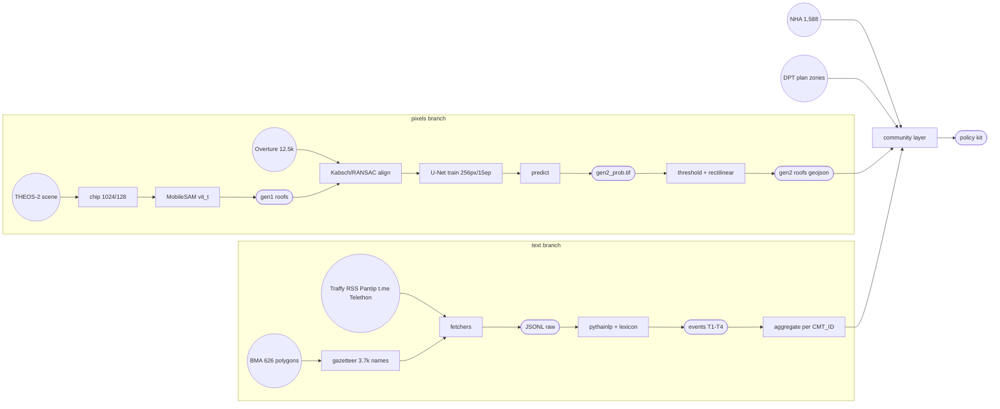

# Slide plan: AI/ML credibility, data pipeline, and limitations

Maps three judging criteria to concrete slides for the deck. Every claim below is
backed by something that exists in the repo — evidence pointers given per slide.

Criteria covered:

1. Is the AI/ML approach appropriate and credible?
2. Is the Data Pipeline clearly explained?
3. Are data limitations and uncertainty acknowledged?

---

## Part 1 — AI/ML approach: appropriate and credible

**What a judge listens for:** the method matches the problem, there is more than
one iteration with measurable improvement, validation is visible (not "the model
works"), and no inflated claims. Credibility comes from showing the failure of
the naive approach and the fix, not from model names.

### Slide 1.1 — Problem framing: why ML at all

- Goal: map informal settlements and their exposure to plan-zone risk. Core
  geometric primitive = building footprints, so the task is **instance
  segmentation**, not image classification.
- Constraint that shaped everything: no labeled roof dataset for Thai
  informal settlements. This drives the two-generation design below.
- Visual: THEOS-2 scene next to the final roof layer over the same block.

### Slide 1.2 — Generation 1: foundation-model segmentation (SAM)

- MobileSAM (`samgeo`, vit_t) zero-shot on THEOS-2 chips: 1024-px tiles,
  128-px overlap, area filter 4–5,000 m².
- Why appropriate: no training labels needed, works on first scene same day.
- Honest result: detects roofs but footprints are noisy — offsets and ragged
  edges against Overture reference buildings.
- Evidence: `02_code/geo/gen1_samgeo_roofs.py`, live viewer `gen1_samgeo.html`.

### Slide 1.3 — Generation 2: teacher–student distillation to U-Net

- Weak labels: Overture building footprints (12.5k buildings clipped to block)
  used as a geometric teacher — free, city-scale, imperfect.
- Alignment fix: Kabsch/RANSAC similarity transform between SAM centroids and
  Overture centroids before training, so teacher noise does not poison the student.
- Student: U-Net (segmentation_models_pytorch), 256-px chips, 15 epochs;
  artifact `05_models/gen2b_unet.pt`.
- Post-processing: Douglas-Peucker rectilinear regularization — roofs become
  rectangles, usable as polygons for area/coverage stats, not blobs.
- Evidence: `02_code/geo/gen3_fix.py`, viewer `gen2_unet.html`, probability
  raster `theos_block/gen2_prob.tif`.
- Credibility line: *each generation fixed a measured defect of the previous one.*

### Slide 1.4 — Second ML family: Thai NLP event extraction (not a black box)

- Social-signal pipeline is deliberately **rule-based and auditable**:
  pythainlp tokenization, gazetteer matching (3.7k slum-name variants from
  626 BMA polygons), `event_lexicon.yaml` keyword classification.
- No LLM guessing: every event-to-slum match can be traced to a rule and a
  source document. Deterministic, reproducible, cheap.
- Evidence: `02_code/social/extract_events.py`, `event_lexicon.yaml`.

### Slide 1.5 — What we explicitly do NOT claim (anti-hype slide)

- Household/resident numbers are **modeled** (log-normal calibrated to official
  NHA/CODI aggregates), not measured. Labeled as such on the map itself.
- No claim of slum *detection* from pixels at city scale — the THEOS-2 work is
  one scene/block; NHA/BMA registers remain the settlement ground truth.
- This slide is what separates credible from promotional. Keep it.

---

## Part 2 — Data pipeline: clearly explained

**What a judge listens for:** a flow a non-ML person can retell afterwards,
named sources with provenance, and evidence the pipeline is a pipeline
(rerunnable scripts with documented order), not a notebook of one-off steps.

### Slide 2.1 — One end-to-end diagram, two branches

- Left branch (pixels): THEOS-2 scene → chips → SAM → align vs Overture →
  U-Net → regularize → GeoJSON → map layer.
- Right branch (text): 6 fetchers (Traffy, RSS, articles, Pantip, t.me,
  Telethon) → gazetteer+lexicon extraction → tiered events → per-slum
  aggregation (`CMT_ID` key) → choropleth.
- Join: both branches land on the same 626 BMA community polygons — that join
  is the product.
- Visual: node diagram below — dots = data sources, boxes = process steps,
  rounded = artifacts. Same diagram is the slide graphic.

**Node diagram (renders in VS Code preview / GitHub / can paste into slide):**



**ASCII fallback (redraw on whiteboard / slide as dots and lines):**

```
pixels:  (THEOS-2)--(chips)--(SAM)--(gen1)------(align)--(U-Net)--(prob.tif)--(roofs)--.
             (Overture)----------------^                                                       \
text:    (web sources)--(fetchers)--(extract)--(T1-T4)--(aggregate CMT_ID)----------------+--> (community layer)--(policy kit)
             (BMA 626)--(gazetteer)----^                                                       /
registers:  (NHA 1,588)----------------(DPT plan zones)--------------------------------------'
```

### Slide 2.2 — Provenance table (one row per source)

| Source | What it gives | Where used |
|---|---|---|
| GISTDA THEOS-2 (89 GB share, EPSG:32647) | optical scene | roof segmentation |
| Overture buildings | 12.5k footprints | U-Net teacher, alignment |
| NHA gdcatalog 23_01 | 1,588 registered communities | slum map, population model |
| BMA community boundaries | 626 slum polygons (CMT_ID) | join key for everything |
| DPT comprehensive plan zones | land-use zoning | plan-zone overlay/risk |
| Traffy Fondue public API | geocoded complaints | social branch |
| News RSS / Pantip / t.me | event text | social branch |

- Point: every layer on screen has a named public owner. No mystery data.

### Slide 2.3 — Pipeline as code, not craft

- Numbered run order documented in `README_social_pipeline.md` (steps 1–8,
  one script each); flags for window size and volume (`--window-days`, `--max`).
- Polite/legible ingestion: robots.txt checked before article fetch, custom
  UA, rate-safe public APIs only, no API keys in repo.
- Outputs are versioned artifacts (JSONL, parquet, GeoJSON, reports), not
  browser screenshots.
- Evidence: the runbook's outputs table maps every artifact to the step that
  produced it.

### Slide 2.4 — From data to decision (why the pipeline exists)

- The join produces per-community indicators (events per 1k residents,
  Traffy counts, plan-zone category) — the "stale data to policy kit" story
  on `proposal.html`.
- One sentence takeaway: *same polygon key carries pixels, complaints, and
  zoning — that is the policy unit.*

---

## Part 3 — Limitations and uncertainty: acknowledged

**What a judge listens for:** limits named before being asked, each paired
with a mitigation or a roadmap item, and uncertainty made visible in the
product (tiers, labels), not just admitted in a footnote.

### Slide 3.1 — Known limits, owned

- Spatial: roof segmentation validated on **one THEOS-2 block**, not all of
  Bangkok; city-wide claims rest on registers, not pixels.
- Social sources biased toward online, Thai-reading complainants; 92-day
  ingestion window; Google News links are JS redirects so those items stay
  snippet-only (full text only from direct feeds).
- BMA CKAN geo-blocked outside Thai IP (`NEED_THAI_IP.txt` marker) — official
  stats incomplete.
- Population figures modeled, not measured (repeat from 1.5 — judges reward
  hearing it twice).
- Source: `README_social_pipeline.md` "Known limits (2026-10-06 run)".

### Slide 3.2 — Uncertainty is quantified, not hidden

- Match tiers T1–T4 with explicit confidence: T1 name + district 0.9,
  T2 name 0.7 (ambiguous 0.5), T3 district-only 0.4 (population-share
  split), T4 landmark 0.3.
- `match_quality_report.md` ships tier distribution + 20-match skim sample.
- QA gates before release: T1/T2 precision ≥ 0.6 on skim sample; Traffy
  pin-in-polygon rate sanity check.
- U-Net outputs kept as probability raster (`gen2_prob.tif`), thresholding
  is a choice, not baked in.

### Slide 3.3 — Limits as roadmap (close the loop)

- Each limitation mapped to next step: city-wide scenes → scale U-Net;
  geo-blocked CKAN → Thai-IP fetch; snippet-only news → direct-feed expansion;
  T-tier precision → human-in-the-loop review.
- Deferred phases already scoped in the runbook (Traffy 360, FB/TikTok via
  ScrapeCreators) — shows the plan survives contact with reality.

---

## Suggested deck placement and Q&A prep

- Order in deck: 2.1 (pipeline overview) → 2.2–2.4 → 1.1–1.5 (method) →
  3.1–3.3 (limits). Explaining data first makes the ML slides legible.
- Total: ~10–12 content slides for this domain; merge 1.5 into 3.1 if time
  is tight, but never cut both.

Likely judge questions and short answers:

| Question | Answer |
|---|---|
| Why SAM at all if you retrain U-Net? | SAM bootstraps with zero labels; its output plus Overture geometry became the training signal for the cheap, repeatable student model. |
| How accurate is the roof layer? | Generation-over-generation defect reduction shown side by side (gen1 vs gen2 viewers); probability raster preserved for threshold sensitivity. |
| Is the social data representative? | No, and we do not claim it: tier confidences, match-quality report, and the bias limit slide say who is missing. |
| Why not population census per community? | Not published at community level; we model log-normal calibrated to NHA/CODI aggregates and label it modeled on the map. |
| Can this run on another city? | Pipeline is scripts + runbook + gazetteer step; swap registers and scene and the order of operations is unchanged. |
